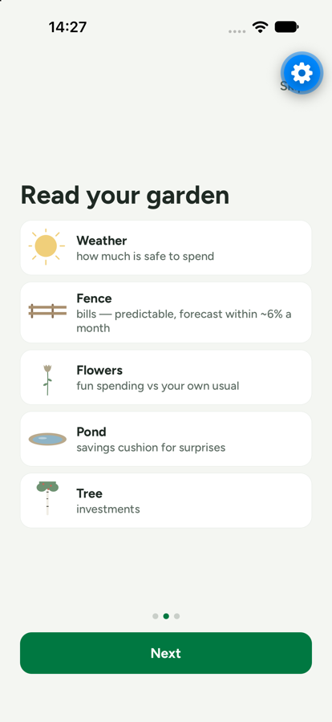
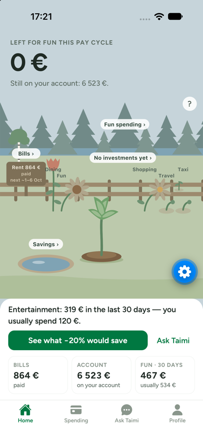
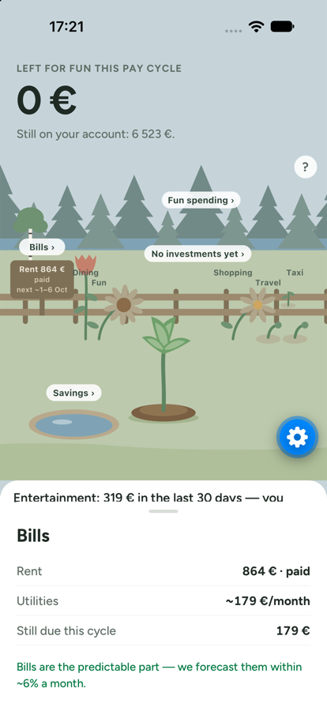
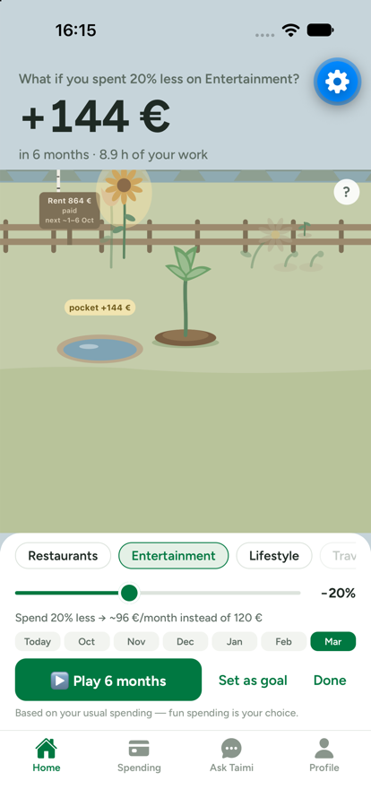
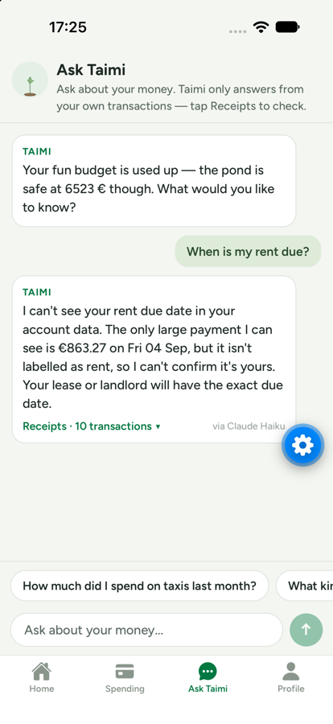

# Taimi — a money coach that knows what it doesn't know

Junction 2026 · S-Pankki challenge **"Personal Economic Trainer"**.

Taimi is a mobile AI coach for S-mobiili customers. Your finances are shown as a calm Nordic garden, and an
agent answers questions about your own transactions. Every number it gives comes from a deterministic tool and
carries its receipts.

<p>
  
  
  
  
  
</p>

## The idea

| In the garden | What it means | How sure we are |
|---|---|---|
| Fence & rent sign | Bills: rent, utilities, transit | Forecast within ~6% a month (backtested) |
| Weather / sky | What's safe to spend until payday | Recomputed daily from the real balance |
| Pond | Cushion for irregular costs (health, repairs) | P90 buffer covered 84% of the next year's months |
| Flowers | Fun spending vs **your own** usual | Not predicted: direction is a coin flip (52%) |
| Tree | Investment deposits | Seen as transfers only |

- **What if, on the garden.** Pick a habit and a cut. Then press *Play 6 months*: coins drop into the pond, the
  flower recovers and the counter ticks up in € and in hours of your work.
- **Ask Taimi.** Free-form chat backed by Claude Haiku, with Gemini Flash Lite as fallback. The LLM only picks
  tools and phrases the answer. A grounding check rejects any answer whose numbers didn't come from a tool. If no
  LLM is available, deterministic templates answer the four challenge questions.
- **Honest by design.** Taimi doesn't predict your fun spending, and it says so. Rent and payday are shown as
  date windows, not fake exact dates.

## Run it

Requirements: Python via [uv](https://docs.astral.sh/uv/), Node 24, Xcode with an iOS simulator (or a browser).
The S-Pankki dataset isn't included. Put the CSVs in `data/spankki/` first.

```bash
uv sync
uv run python -m backend.db                    # one-time DuckDB build (~1-2 min)
uv run --env-file .env uvicorn backend.main:app --port 8000 --host 0.0.0.0
cd app && npm install && npx expo start         # then press w for web, or open in Expo Go
```

Optional keys in `.env`: `ANTHROPIC_API_KEY`, `GEMINI_API_KEY`. Without them, chat runs on templates.
To pick a demo persona, use Profile, or deep-link with `exp://<host>:8081/--/?persona=CUST00359`.

## Repo map

| Path | What |
|---|---|
| `backend/` | FastAPI + DuckDB: garden state, simulation, transactions, chat agent + tools |
| `app/` | Expo / React Native app (Expo Router, react-native-svg, Reanimated) |
| `tests/` | pytest: regression vs. direct SQL, simulation, grounding, API |
| `experiments/` | Dataset backtest (`spankki_backtest.py`) and sanity checks |
| `prototype/taimi/` | Single-file HTML design prototype |
| `HANDOFF.md` | Full design notes, data findings and decisions (Polish) |

## Tests

```bash
uv run pytest -q
cd app && npx tsc --noEmit
```
